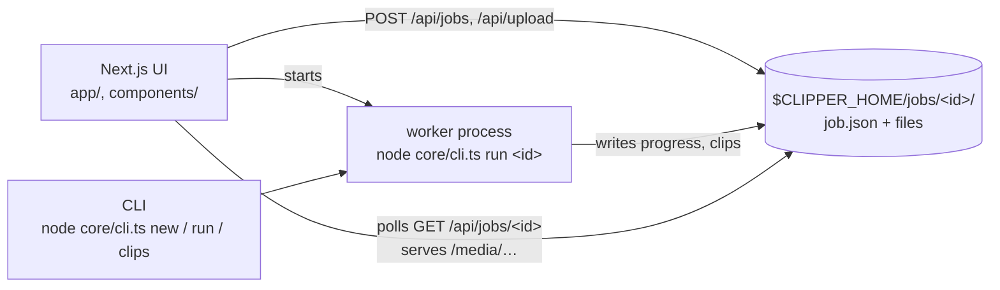

# MotionMind Clipper: design (v0.1)

This document describes what is built and working. Usage is in [README.md](README.md).

## 1. What it does

Input: a stream VOD as a link (YouTube, TikTok, anything yt-dlp reads) or a video file. Output: vertical 1080×1920
clips of the strongest moments, each with its subtitles as `.srt` and `.txt`. The user asks for N clips anywhere and,
optionally, M clips from each of several time ranges (e.g. a boss fight). Detection is game-agnostic: it uses only the
stream's audio, the picture and what is said.

## 2. Architecture



- **One folder per job**, `job.json` is the single source of truth (status, steps with progress text, clips). The
  worker rewrites it atomically (temp file + rename); the UI only reads it, except subtitle edits on finished jobs.
- **The worker is a separate, detached Node process** (Node's type stripping runs `core/*.ts` directly), so a job
  survives page reloads and does not block the UI server.
- **External tools**: ffmpeg/ffprobe for everything audio/video, yt-dlp for links, openai-whisper for speech. No
  model or service is bundled; without whisper, clips have no subtitles.
- **Local request boundary**: `proxy.ts` rejects non-loopback `Host` values (DNS rebinding) and foreign origins /
  cross-site browser fetches before pages, APIs or media routes run. CLI clients without browser headers still
  work. This is defense in depth for the loopback-only server, not authentication or a sandbox.

Code map:

| File | Role |
|---|---|
| `core/jobs.ts` | job model, `job.json` read/write, `$CLIPPER_HOME` |
| `core/pipeline.ts` | the five steps, agent windows (`renderWindows`) |
| `core/signals.ts` | per-second signals, recurring screens, peaks |
| `core/words.ts` | `words.txt` parsing, checks, Whisper prompt, keyword matching, caption cleaning |
| `core/captions.ts`, `core/cues.ts` | words → subtitle lines, `.srt` / `.txt` |
| `core/subtitles.ts` | saving edited subtitles |
| `core/range.ts`, `core/format.ts` | time ranges, time formatting/parsing |
| `core/worker.ts`, `core/cli.ts` | starting the worker, command line |
| `proxy.ts`, `tests/local-access.test.ts` | loopback / origin boundary and its regression checks |
| `tests/pipeline.test.ts` | CLI end to end on synthetic footage (file, windows, link via yt-dlp); CI on Ubuntu + Windows |

## 3. Pipeline

### 3.1 Download

- **Link**: `yt-dlp -J` for title, length, uploader, thumbnail.
  - Up to 10 min long: the whole video at ≤ 1080p is downloaded and used as the source.
  - Longer: only an audio track (`ba[ext=m4a]`) and a ≤ 160p video are downloaded for analysis; each picked clip is
    later downloaded alone at ≤ 1080p with `--download-sections`.
- **File**: used in place (uploads are streamed to `jobs/<id>/source/`, never buffered in memory).
- Then: `audio.wav` (16 kHz mono) and `proxy-video.mp4` (5 fps, 256 px wide) for analysis.

### 3.2 Signals (every second)

All from ffmpeg output, computed in Node.

| Signal | How |
|---|---|
| speech band | RMS dB after `highpass=300,lowpass=3400` |
| game band | max of RMS dB below 250 Hz and above 4 kHz (impacts, explosions, gunfire) |
| speech present | speech band above its 20th percentile + 6 dB and within 4 dB of the full-band level |
| voice | rolling z-score of the speech band, counted only where speech is present (mixed tracks: explosions also hit the speech band) |
| game | rolling z-score of the game band |
| motion | rolling z-score of ffmpeg's scene score (5 fps, 128 px) |
| recurring screens | a 64-bit difference hash of each second's frame; a second whose frame matches (Hamming ≤ 5) many seconds elsewhere in the video (≥ 12, or 0.4 % of its length, at least 30 s away) is a loading, respawn, title or menu screen |

Rolling z-scores use the median and MAD of a 5-minute window, so a loud game or a loud streamer is not "always a
highlight". Score per second = 0.5 voice + 0.3 game + 0.2 motion (each clamped to 0…8, smoothed over 3 s), and 0 on
recurring screens.

### 3.3 Peaks

- The highest-scoring seconds, at least 60 s apart (20 s when the searched span is ≤ 15 min); per group, 4× the clips
  wanted (at least 8).
- **Death/round-end rule**: when a recurring screen starts within 12 s after a peak, the peak moves back to the
  strongest voice + game burst in the 40 s before it (the moment happens before the loading screen, not on it).
- **Groups**: each time range is searched on its own; the "anywhere" search ignores seconds inside any range.

### 3.4 Transcription

openai-whisper (`small`, language `id` by default) with word timestamps, only around the strongest peaks
(peak − 20 s … + 50 s, merged where they overlap; 2× the clips wanted per group, at least 3). The prompt is built from
the word list (names first, then excitement words). Results are cached per region.

### 3.5 Picking clips

- **Window**: peak − 10 s … + 8 s; extended while speech continues (next word within 1 s, 45 s maximum), plus 1.5 s
  of reaction; the start never cuts a word; at least 15 s.
- **Score**: the peak's score + 0.35 per excitement word from the word list in the window (at most + 1.05).
- **No overlaps**: ranges are picked first; clips never overlap each other, and clips "anywhere" never enter a range.
- Every clip keeps its reasons (e.g. `voice +2.9σ`, `words: mati`, `moved back from 0:28:38`).

### 3.6 Cut and render

- Source: the local file or the downloaded section.
- Video: 1080×1920 "fit-blur": the whole frame scaled into the middle over a blurred, darkened copy that fills the
  frame; 30 fps, H.264 CRF 20.
- Audio: two-pass `loudnorm` to −14 LUFS, true peak −1.5 dB, AAC 160 kb/s.
- Poster: the frame at the peak.

### 3.7 Agent windows

`node core/cli.ts clips <job> "H:MM:SS-H:MM:SS|why" …` replaces a finished job's clips with exact windows: the
windows are transcribed, downloaded and rendered the same way; the note becomes the first reason. For moments a
person or an agent picked from the video itself.

## 4. Subtitles

- Raw Whisper words are stored per clip and never changed.
- Lines: ≤ 7 words, ≤ 3.2 s, split at pauses > 0.6 s and sentence ends.
- `.srt`: the lines with the word list's `[koreksi]` then `[sensor]` applied. `.txt`: clip time, source time and the
  verbatim text, unsure words (probability < 0.5) as `(?word)`.
- **Editing** (finished jobs): lines can be retyped, retimed, deleted and added in the UI; saved lines live in
  `clip.cues` and rewrite both files. "Reset to Whisper" removes them.

## 5. Word list (`words.txt`)

Plain text so it can be edited without JSON. `defaults/words.txt` ships with the app;
`$CLIPPER_HOME/words.txt` is the user's own and is added on top (created on first run, editable in the UI).

```text
# comment
[seru]
walaah
mati meneh
[nama]
Fader
[koreksi]
Tentang mati => Tetep mati
[sensor]
anjing
```

| Section | Used for |
|---|---|
| `[seru]` | excitement words/phrases: keyword bonus when picking |
| `[nama]` | players, bosses, items: Whisper's vocabulary prompt |
| `[koreksi]` | `misheard => correct`, whole words, applied to the `.srt` |
| `[sensor]` | masked in the `.srt` (`anjing` → `anj*ng`); also counts as excitement |

One entry per line, case-insensitive matching, multi-word entries allowed. The UI rejects unknown sections, lines
above the first section and `[koreksi]` lines without `=>`.

## 6. Data

```text
$CLIPPER_HOME (default ~/MotionMindClipper)
├── words.txt
└── jobs/<id>/
    ├── job.json                 input, count, ranges, status, steps, source info, clips
    ├── worker.log
    ├── source/                  uploaded file, or the whole video for short links
    ├── .clipper/                audio.wav, proxies, signals.json, peaks.json, words.json, whisper/ cache
    └── clips/01/                video.mp4, poster.jpg, captions.srt, transcript.txt, clip.json
```

## 7. Interfaces

| Surface | What |
|---|---|
| `/` | import: link or file, clips anywhere, time ranges (click-only H:MM:SS pickers bounded by the video length), word list modal, recent videos |
| `/j/<id>` | live steps, clips grouped by range, player, reasons, downloads, subtitles (raw or edited) |
| `POST /api/jobs` | `{url, count, ranges[], duration}` |
| `POST /api/upload?name&count&ranges&duration` | raw file body |
| `GET /api/jobs/<id>` | `job.json` |
| `GET /api/probe?url=` | title, length, thumbnail of a link |
| `GET/PUT /api/words` | the user's word list |
| `PUT /api/jobs/<id>/clips/<clip>/subtitles` | `{cues}` or `{cues: null}` to reset |
| `GET /media/<id>/…` | job files, with HTTP Range for seeking |
| CLI | `new <link\|file> [--count N] [--range H:MM:SS-H:MM:SSxN]…`, `run <id>`, `clips <id> "a-b\|note"…` |

## 8. Settings

| Variable | Default |
|---|---|
| `CLIPPER_HOME` | `~/MotionMindClipper` |
| `CLIPPER_WHISPER_MODEL` | `small` |
| `CLIPPER_LANGUAGE` | `id` |
