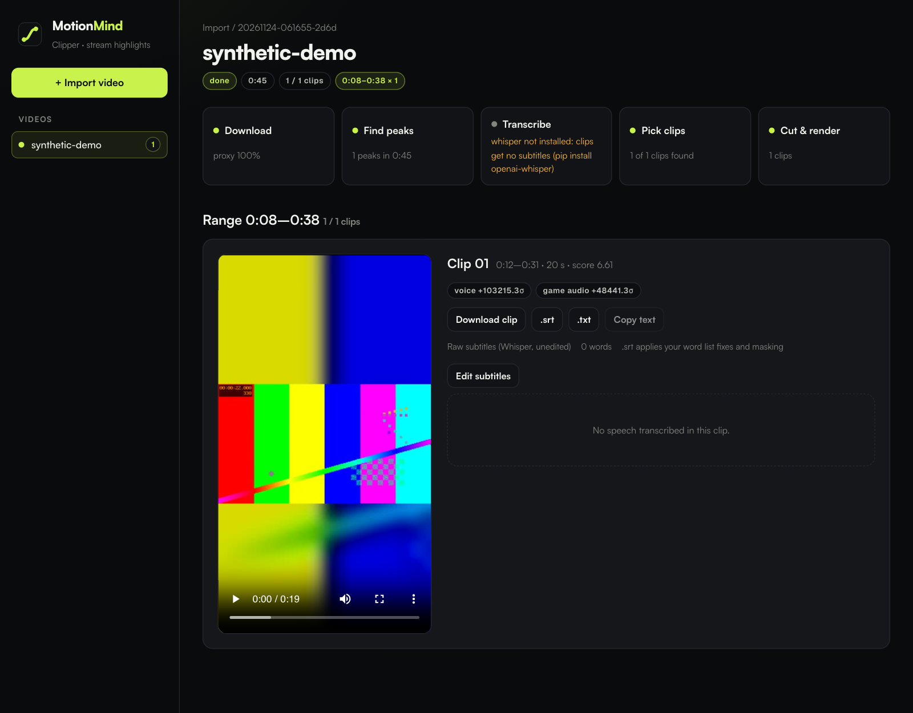
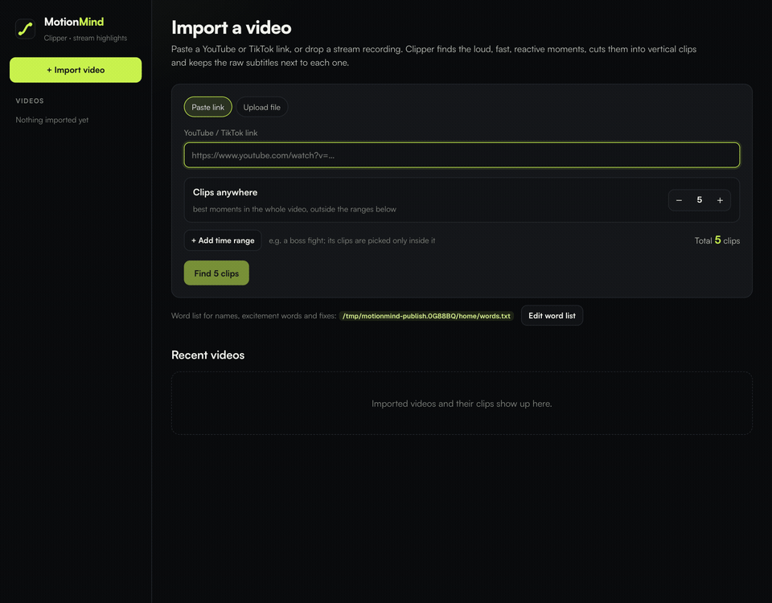
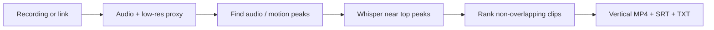

# MotionMind Clipper

**Turn long gaming VODs into vertical clips. Keep the processing on your machine.**

Import a recording or a YouTube / TikTok link, choose where to look, and export
1080 × 1920 clips with editable subtitle sidecars. No account or paid API key required.

**v0.1.0 · Alpha · MIT · Local, single-user app**

> Ready to experiment, not an automatic editor you can leave unchecked.
> Highlight selection is heuristic; review the picks and subtitles before publishing.

## A look inside



*Real UI, original synthetic test footage. This demo ran without Whisper; it demonstrates
the file → analysis → vertical export path, not subtitle accuracy or gaming highlight quality.*

### Plan your clips



*Actual UI states, condensed into a looping walkthrough. No personal VODs, account data,
or third-party video footage are included in these assets.*

## What you can do

- **Import a link or file.** Links use [yt-dlp](https://github.com/yt-dlp/yt-dlp);
  recordings are streamed to disk rather than buffered in memory.
- **Choose clips anywhere, inside time ranges, or both.** For example, five clips
  from a stream plus three from a boss fight. Ranges cannot overlap; “anywhere” picks
  stay outside those ranges.
- **See why a moment was picked.** Voice, game-audio and motion peaks drive selection;
  excitement words add a scoring bonus. Recurring loading/menu screens are suppressed.
- **Export vertical video.** H.264 / AAC MP4, 1080 × 1920 at 30 fps, full frame over
  a blurred background, with audio normalization targeting −14 LUFS.
- **Review and edit subtitles.** Click Whisper words to seek; edit, retime, add or
  delete subtitle lines. Download `.srt` / `.txt`, or reset edits to the original words.
- **Teach it your vocabulary.** A plain-text word list holds names, excitement phrases,
  transcription corrections and words to mask in captions.

## How it works



Whisper is optional: without it, transcription is skipped and subtitle files contain no
recognized speech. For links longer than ten minutes, Clipper analyzes audio and a low-resolution
proxy first, then downloads the selected sections at higher quality.
See [DESIGN.md](DESIGN.md) for the scoring rules, architecture and API.

## Quick start

Clone this repository using GitHub's **Code** menu, then open its directory in your terminal.

### 1. Install the tools

| Tool | Needed for |
| --- | --- |
| Node.js **22.18+** and npm | UI, CLI and background worker; native TypeScript execution |
| `ffmpeg` and `ffprobe` on `PATH` | All video/audio analysis and rendering |
| `yt-dlp` on `PATH` | Importing links; not needed for local recordings |
| `whisper` on `PATH` | Optional local transcription; provided by `openai-whisper` |

On **macOS with Homebrew**:

```bash
brew install node ffmpeg yt-dlp
```

For subtitles, install [openai-whisper](https://github.com/openai/whisper) in a Python
environment. Python 3.11 is a conservative choice:

```bash
brew install python@3.11
python3.11 -m venv .venv
source .venv/bin/activate
python -m pip install --upgrade openai-whisper
whisper --help
```

Keep that environment active when starting Clipper so the worker can find `whisper`.
The first transcription downloads the selected model; allow time and disk space for
the model, recordings, proxies and rendered clips.

On Linux, install Node and FFmpeg using your preferred package manager, then follow
the upstream yt-dlp and Whisper installation instructions. macOS / Apple Silicon
is the exercised platform; Linux media processing and Windows are not verified.

### 2. Start Clipper

From the cloned repository:

```bash
npm ci
npm run build
npm start
```

Open **http://127.0.0.1:4320**. For development, use `npm run dev` instead.
Optional UI fonts are not distributed; system fallbacks work out of the box.
See [font setup](public/fonts/README.md).

### 3. Make your first clips

1. Choose **Paste link** or **Upload file**, then select a source you have permission to use.
2. Set **Clips anywhere**. Add time ranges for specific fights, rounds or reactions;
   set “anywhere” to zero if you only want clips from those ranges.
3. Click **Find … clips**. The job page shows download, analysis, transcription,
   selection and rendering progress. Reloading the page does not stop the worker.
4. Review each clip, fix subtitles if needed, and download the MP4 and sidecars.

The requested count is a target, not a guarantee: short sources or too few
non-overlapping candidates can produce fewer clips.

## Command line

Run these commands from the repository root, with the same tools on `PATH`:

```bash
# Local recording
npm run clip -- new ./stream.mp4 --count 5

# Replace VIDEO_ID with a real video ID
npm run clip -- new "https://www.youtube.com/watch?v=VIDEO_ID" \
  --count 5 --range 1:00:30-1:11:00x3

# Re-run an existing job (replaces its current clip list)
npm run clip -- run JOB_ID

# Replace a finished job's clips with exact source-time windows
npm run clip -- clips JOB_ID \
  "1:01:36-1:02:12|boss appears" \
  "1:08:44-1:09:28|boss defeated"
```

Use the actual ID printed by the CLI in place of `JOB_ID`.
**`clips` replaces the job's existing clip directory, including subtitle edits.**
Copy exports you want to keep before re-rendering.

## Configuration and data

Export settings in the shell **before** starting the UI or CLI; detached workers inherit them:

```bash
export CLIPPER_HOME="$HOME/MotionMindClipper"
export CLIPPER_WHISPER_MODEL="small"
export CLIPPER_LANGUAGE="id"
npm start
```

| Variable | Default | Purpose |
| --- | --- | --- |
| `CLIPPER_HOME` | `~/MotionMindClipper` | Job files, uploads, exports and your word list |
| `CLIPPER_WHISPER_MODEL` | `small` | Whisper model; larger models need more resources |
| `CLIPPER_LANGUAGE` | `id` | Transcription language, e.g. `en` for English |

```text
~/MotionMindClipper/
├── words.txt                 Your vocabulary, created on first use
└── jobs/<id>/
    ├── job.json              Source, progress, selection reasons and edits
    ├── worker.log            Background worker output
    ├── source/               Uploaded file or downloaded short video
    ├── .clipper/             Audio, proxies, signals and transcription cache
    └── clips/01/
        ├── video.mp4
        ├── poster.jpg
        ├── captions.srt
        ├── transcript.txt
        └── clip.json
```

Use **Edit word list** on the import page, or edit `words.txt` directly.
Your entries are added to [the defaults](defaults/words.txt); word-list changes apply to
future processing. The [format reference](DESIGN.md#5-word-list-wordstxt) explains each section.
There is no automatic storage cleanup; archive or remove finished job folders when no
worker is using them.

## Limits and safety

- **Heuristics, not semantic understanding.** Loudness and motion can miss a quiet clutch
  or overrate camera movement. Long, uniformly intense fights may not stand out.
  Constrain the search with ranges, or use exact CLI windows.
- **Subtitles need review.** Mixed game audio, names and overlapping voices can confuse
  Whisper. Subtitles are separate files, **not burned into the MP4**.
- **One layout.** Fit-blur preserves the source frame; it does not separately arrange
  a facecam and gameplay.
- **Local only, no authentication.** Start scripts bind to `127.0.0.1`; request guards
  reject non-loopback hosts and cross-origin browser requests. These are not a substitute
  for authentication or isolation. Do not deploy this on Vercel, a public server,
  a tunnel, a shared machine, or a reverse proxy.
- **Not a sandbox.** Clipper launches local media tools with your user permissions.
  Keep FFmpeg, yt-dlp and Whisper updated; use trusted inputs.
- **Network is still used.** Link imports contact the source platform; Whisper downloads
  model weights on first use. Media processing does not use a hosted inference API.
  Remote thumbnails may also be loaded by your browser.
- **Rights matter.** Only download, clip and publish material you own or have permission
  to use, and follow the source platform's terms. The code's MIT license does not grant
  rights to third-party recordings, fonts or model weights.

## Contributing

Small, focused issues and pull requests are welcome. Include the platform, Node and
media-tool versions, steps to reproduce, and expected vs. actual behavior.
Redact private URLs, local paths, transcripts and credentials from logs.
Do not attach copyrighted recordings without permission.

```bash
npm ci
npm run typecheck
npm test
npm run build
```

CI runs these checks on Node 22.18 and 24. The current regression tests cover local
request boundaries, not highlight quality or the full media pipeline. For processing
changes, also exercise a short recording you are allowed to share and inspect the output.
Keep job data, models, recordings, optional font files and personal word lists out of PRs.

For security problems, prefer GitHub's private vulnerability reporting if enabled.
Do not post credentials or working exploits in a public issue.

## Release notes · v0.1.0 alpha

- Local UI and CLI for heuristic highlight selection, time ranges and vertical exports.
- Optional Whisper transcription, word-list customization and subtitle editing.
- Publication hardening: loopback / origin guards, regression checks and GitHub Actions CI.

## License

[MIT](LICENSE) © 2026 Vinzzztty. External tools, models and optional fonts retain
their respective licenses. The README screenshots and GIF use original synthetic footage.
